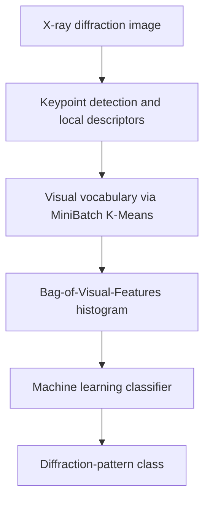

# Machine Learning for X-ray Serial Crystallography Data Reduction

Research code for classifying X-ray diffraction patterns using **local image features**, a **Bag of Visual Features (BoVF)** representation, and classical **machine learning**. The approach is related to our peer-reviewed work in *Journal of Applied Crystallography* (2023).

> **Repository status:** Legacy research implementation originally developed in 2021, subsequently supplemented with documentation and synthetic-data software tests. This is a research prototype, not a maintained production package. **The original GitLab history and its contents are preserved:** verify the licensing, confidentiality, and redistribution permissions for any data, model files, or generated artifacts before making this repository public.

## Research publication

**V. Rahmani, S. Nawaz, D. Pennicard, S. P. R. Setty, and H. Graafsma** (2023). “Data reduction for X-ray serial crystallography using machine learning.” *Journal of Applied Crystallography*, **56**(1), 200–213.  
**DOI:** [10.1107/S1600576722011748](https://doi.org/10.1107/S1600576722011748)

Please cite the publication when using this research implementation. A ready-to-use BibTeX entry is provided under [Citation](#citation), in [`CITATION.cff`](CITATION.cff), and in [`references.bib`](references.bib).

## Motivation

Serial crystallography produces large collections of diffraction images. A practical processing pipeline needs a way to characterize diffraction patterns and classify them into meaningful categories. This repository explores a classical computer-vision alternative to end-to-end image classifiers: extracting local features first, then using a compact image representation for machine learning.

## Methodology



**Image feature methods:** ORB, SIFT, SURF, BRISK, AKAZE, KAZE, BRIEF and FREAK appear in the original implementation or interface. Availability and compatibility differ by OpenCV build; consult [known issues](KNOWN_ISSUES.md).

**Representations:** Local descriptors are quantized using `MiniBatchKMeans`; each diffraction image is then represented by a fixed-length visual-word histogram.

**Classifiers:** Random Forest, Support Vector Machine (SVM), Multi-Layer Perceptron (MLP), and Naive Bayes.

**DiffraNet categories:** `Blank`, `No-Crystal`, `Weak`, `Good`, `Strong`.

## Project layout

| Location | Purpose |
| --- | --- |
| `main.py` | Command-line experiment pipeline |
| `features.py` | Keypoint detection, descriptors, visual vocabulary, BoVF histograms |
| `rf.py`, `svm.py`, `nb.py`, `multilayer.py` | Machine-learning classifiers |
| `datasets.py`, `parameters.py` | Dataset layout and model configuration |
| `save_models.py`, `save_figures.py`, `outputs.py` | Serialization and experiment-output utilities |
| `tests/` | Synthetic-data unit and integration tests |
| `.github/workflows/tests.yml` | Continuous integration with GitHub Actions |
| `TESTING.md` | Test setup and scope |
| `KNOWN_ISSUES.md` | Legacy compatibility notes and documented repairs |
| `Datasets/`, `Features/`, `Saves/`, `Figures/`, `Outputs/` | Legacy data and generated-artifact locations; check their contents and publication permissions |
| `CITATION.cff`, `references.bib` | Publication citation metadata |

## Installation

Requires Python and libraries listed in `requirements.txt`. A virtual environment is recommended:

```bash
python -m venv .venv
# Linux / macOS: source .venv/bin/activate
# Windows PowerShell: .venv\Scripts\Activate.ps1
python -m pip install -r requirements.txt
```

The original project predates some current OpenCV/scikit-learn APIs, so individual descriptor configurations may need adaptation. Dependencies are not pinned to an archival environment.

## Dataset layout

For the `DiffraNet` option, the workflow expects grayscale-readable images organized as follows. Whether the transferred GitLab repository already includes files in these directories must be checked locally:

```text
Datasets/DiffraNet/Dataset/
├── Train/
│   ├── Blank/
│   ├── Good/
│   ├── No-Crystal/
│   ├── Strong/
│   └── Weak/
└── Test/
    ├── Blank/
    ├── Good/
    ├── No-Crystal/
    ├── Strong/
    └── Weak/
```

Check the dataset's redistribution and usage permissions before obtaining or sharing the images. The legacy `AGIPD` option has a path-selection issue documented in [KNOWN_ISSUES.md](KNOWN_ISSUES.md).

## Run the pipeline

Example using ORB descriptors and a Random Forest classifier:

```bash
python main.py --MLmodel RF --detector ORB --descriptor ORB --dataset DiffraNet
```

Other `--MLmodel` values are `SVM`, `MLP`, and `NB`. Use `python main.py --help` to view available command-line arguments. This full workflow requires the appropriate image dataset.

## Automated software tests

Unit and integration tests use **synthetic images and feature vectors** and do not require any private or experimental diffraction datasets.

```bash
python -m pip install -r requirements-dev.txt
python -m pytest -q
```

GitHub Actions runs the same tests on push and pull requests. See [TESTING.md](TESTING.md) for covered components and limitations.

## Historical repository and privacy

This project was transferred from a private institutional GitLab repository to preserve authentic commit history. Adding `.gitignore` prevents some **new** artifacts from being tracked, but it **does not remove any files already committed**, including old commits. Inspect tracked files and obtain the necessary permissions before setting the destination repository to public.

## Implementation notes

The current repository preserves the research structure and makes a small set of documented correctness/compatibility repairs. Some older feature options need modernization. The legacy GitLab repository may contain experimental data, pretrained artifacts, or generated outputs in its current tree or Git history; audit before release. See [KNOWN_ISSUES.md](KNOWN_ISSUES.md) before adapting the code for another dataset or environment.

Please verify that you have the necessary permission to release and reuse project files and scientific data.

## Citation

If this repository supports your work, please cite the related paper:

```bibtex
@article{rahmani2023data,
  title     = {Data reduction for X-ray serial crystallography using machine learning},
  author    = {Rahmani, Vahid and Nawaz, Shah and Pennicard, David and Setty, Shabarish Pala Ramakantha and Graafsma, Heinz},
  journal   = {Journal of Applied Crystallography},
  volume    = {56},
  number    = {1},
  pages     = {200--213},
  year      = {2023},
  publisher = {International Union of Crystallography},
  doi       = {10.1107/S1600576722011748}
}
```

## Technology stack

Python · OpenCV · NumPy · scikit-learn · Matplotlib · joblib · pytest · GitHub Actions
